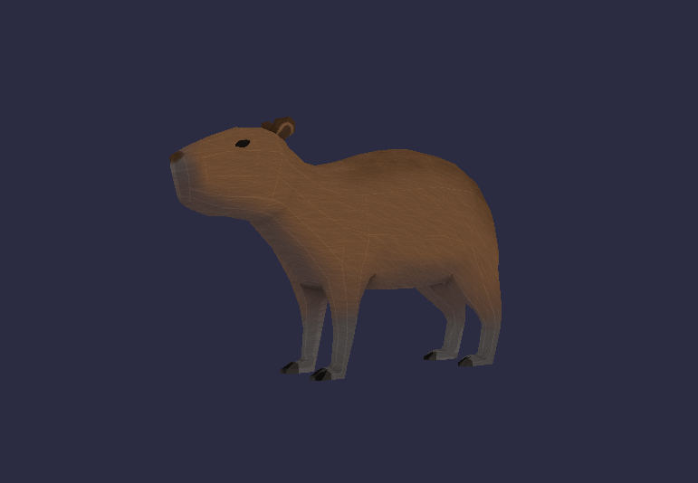
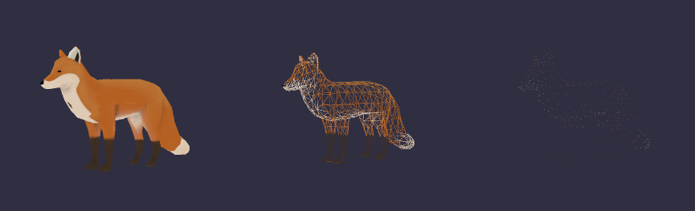

# Scop
*This project has been created as part of the 42 curriculum by lboudjem*

# Description

**Scop** est un moteur de rendu 3D minimaliste développé en **C++** et **OpenGL**. Ce projet a pour objectif d'implémenter les fondements graphiques 3D de bas niveau, allant du chargement de fichiers d'objets (`.obj`) et de textures jusqu'à la gestion des shaders et des transformations matricielles.



https://github.com/user-attachments/assets/d215a7db-0e75-4182-8885-4f6f3b695096

# Instructions

#### Installation:

    git clone git@github.com:Louisa4124/Scop.git
    cd ./scop
    make

#### Utilisation:

    ./scop [fichier .obj]

#### Exemple:

    ./scop ./assets/42.obj

## Contrôles:

- **`w` `a` `s` `d` `q` `e`** : Déplacer le modèle sur les axes x, y et z
- **`↑` `↓` `→` `←` `0` `.`** : Tourner le modèle manuellement
- **`1` `2` `3`** : Activer les rotations constantes du modèle
- **`c`** : Changer le mode de couleur
- **`t`** : Activer / désactiver la texture
- **`m`** : Changer le mode d'affichage (fil de fer, remplissage, points)
- **`+` `-`** : Augmenter / réduire la vitesse de rotation
- **`Esc`** : Fermer la fenêtre 


*Differents modes d'affichage du modèle*

# Fonctionnement 

### Parsing

Le format **.obj** est un fichier texte où chaque ligne commence par un identifiant indiquant la nature de la donnée.

Les principaux identifiants sont les suivants:

- **v** : Position d'un sommet *(x, y, z)*
- **vt** : Coordonnées de texture *(u, v)*
- **vn**: Vecteur normal *(x, y, z)*
- **f** : Une face

Exemple:

```obj
# Pyramide à base carrée
# ---------------------

# 1. Sommets (v x y z)
v -0.5 0.0 -0.5  # 1 : Coin bas-gauche
v  0.5 0.0 -0.5  # 2 : Coin bas-droit
v  0.5 0.0  0.5  # 3 : Coin haut-droit
v -0.5 0.0  0.5  # 4 : Coin haut-gauche
v  0.0 1.0  0.0  # 5 : Sommet de la pyramide

# 2. Faces (f v1 v2 v3 ...)
# Remarque : Les indices commencent à 1 en format OBJ.

# Base de la pyramide (2 triangles)
f 1 2 3
f 1 3 4

# Faces latérales de la pyramide (4 triangles)
f 1 2 5
f 2 3 5
f 3 4 5
f 4 1 5
```
---
#### Structure d'une face

Chaque ligne **f** définit un triangle/polygone. Les valeurs font référence aux indices des listes **v**, **vt**, et **vn** lues plus haut dans le fichier.

Dans le cas de polygones, etant donner que OpenGL ne sait pas afficher directements ces formes avec ```GL_TRIANGLES```, on doit effectuer une triangulation et decouper les polygones en triangles.

Les faces peuvent aussi avoir des textures/normales, et se presentent sous les formes suivantes:

- Position seule : **f v1 v2 v3**
- Position et Coordonnées de Texture : **f v1/vt1 v2/vt2 v3/vt3**
- Position, Texture et Normale : **f v1/vt1/vn1 v2/vt2/vn2 v3/vt3/vn3**
- Position et Normale : **f v1//vn1 v2//vn2 v3//vn3**

---
### Textures

En plus des positions géométriques et des normales, un fichier **.obj** peut inclure des informations permettant d'appliquer une texture sur le modèle 3D, avec une image 2D.

- **vt** : Coordonnées de texture *(u, v)*

Exemple de données de texture dans un fichier OBJ :

```obj
# 1. Coordonnées de texture (vt u v)
vt 0.0 0.0
vt 1.0 0.0
vt 1.0 1.0
vt 0.0 1.0
```

Que sont u et v ? Contrairement au repère 3D (x, y, z), une image 2D utilise un repère plat souvent noté (u, v) (ou (s, t)).

   -  u va de gauche (0.0) à droite (1.0).
   -  v va du bas (0.0) au haut (1.0).

Dans l'exemple donné plus haut, on définis les 4 coins de l'image 2D:

   -  vt 0.0 0.0 = Coin bas-gauche de l'image.
   -  vt 1.0 0.0 = Coin bas-droit de l'image.
   -  vt 1.0 1.0 = Coin haut-droit de l'image.
   -  vt 0.0 1.0 = Coin haut-gauche de l'image.

On associe ensuite dans la face:

```obj
f 1/1/1 2/2/1 3/3/1
```

Donc, si on suit la structure des faces avec textures donnée plus haut, on a :

`Indice_Position` / `Indice_Texture (UV)` / `Indice_Normale`

1. Premier coin : **1/1/1**
   -  Le sommet géométrique (v) est le n°1 (sa position 3D dans l'espace).
   -  La coordonnée de texture (vt) est la n°1 (donc 0.0 0.0, le coin bas-gauche de l'image).
   -  La normale (vn) est la n°1.

2. Deuxième coin : **2/2/1**
   -  Le sommet géométrique (v) est le n°2.
   -  La coordonnée de texture (vt) est la n°2 (1.0 0.0, le coin bas-droit de l'image).
   -  La normale est la n°1.

3. Troisième coin : **3/3/1**
   -  Le sommet géométrique (v) est le n°3.
   -  La coordonnée de texture (vt) est la n°3 (1.0 1.0, le coin haut-droit de l'image).
   -  La normale est la n°1.

---
### Textures procédurales (Génération automatique sans `vt`)

Si un fichier **.obj** ne contient pas de coordonnées de texture (`vt`), ce qui est le cas de l'objet 42.obj fournit dans ce projet: il est possible de contourner le problème en générant les coordonnées UV directement dans le code C++ de manière mathématique. 

Cette technique est appellée **Planar Mapping**.

#### Principe de fonctionnement

Au lieu de lire les `vt` dans le fichier, le programme calcule les coordonnées UV à partir de la position spatiale `(x, y, z)` de chaque sommet :

1. **Calcul de la **Bounding Box** :**
   On recherche d'abord les limites de l'objet sur deux axes (par exemple $X$ et $Y$) en trouvant les valeurs minimales et maximales :
   - $X_{min}$ et $X_{max}$
   - $Y_{min}$ et $Y_{max}$

2. **Normalisation des coordonnées :**
   On projette la position du sommet sur un plan 2D et on ramène ses coordonnées entre `0.0` et `1.0` à l'aide d'une formule de proportionnalité :

   $$u = \frac{x - X_{min}}{X_{max} - X_{min}}$$
   $$v = \frac{y - Y_{min}}{Y_{max} - Y_{min}}$$

# Resources

- https://opengl.developpez.com/tutoriels/apprendre-opengl/
- https://www.scratchapixel.com/lessons/3d-basic-rendering/obj-file-format//obj-file-format.html
- https://www.ronja-tutorials.com/post/008-planar-mapping/
- https://webglfundamentals.org/webgl/lessons/webgl-planar-projection-mapping.html
- https://www.geeksforgeeks.org/cpp/cpp-program-to-rotate-matrix-elements/
- https://cplusplus.com/articles/GwvU7k9E/
- https://www.scratchapixel.com/lessons/3d-basic-rendering/perspective-and-orthographic-projection-matrix//opengl-perspective-projection-matrix.html

### 3D models:
- https://poly.pizza/m/66d-mKAgF17
- https://poly.pizza/m/0OToIgkcVM7
- https://poly.pizza/m/10u8FYPC5Br
- https://poly.pizza/m/d2QPCNGeGp3
